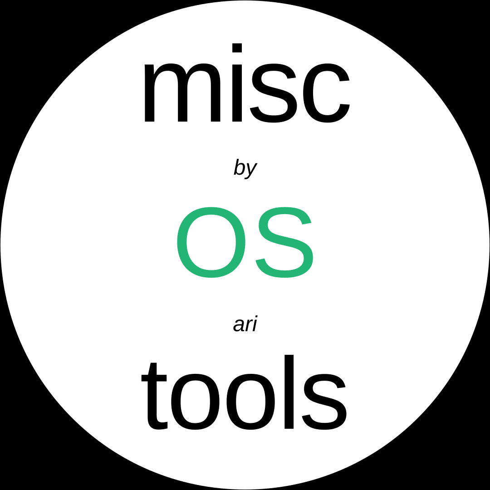

  

  Small tools for OS setup and everyday use.

# Misc OS Tools

A collection of scripts and utilities I use for setting up and managing my systems.

## What's here

- [Remote tools](RemoteTools/README.md) — SSH-oriented utilities and Sway helpers, with installation notes and per-script guides.
- [Sway Monitor TUI](SwayMonitorTUI/README.md) — terminal interface for managing Sway monitors.

## Notes

These tools are primarily built for my own setup, so they may need adapting before they work on yours. Check each tool's documentation and review scripts before running them.
